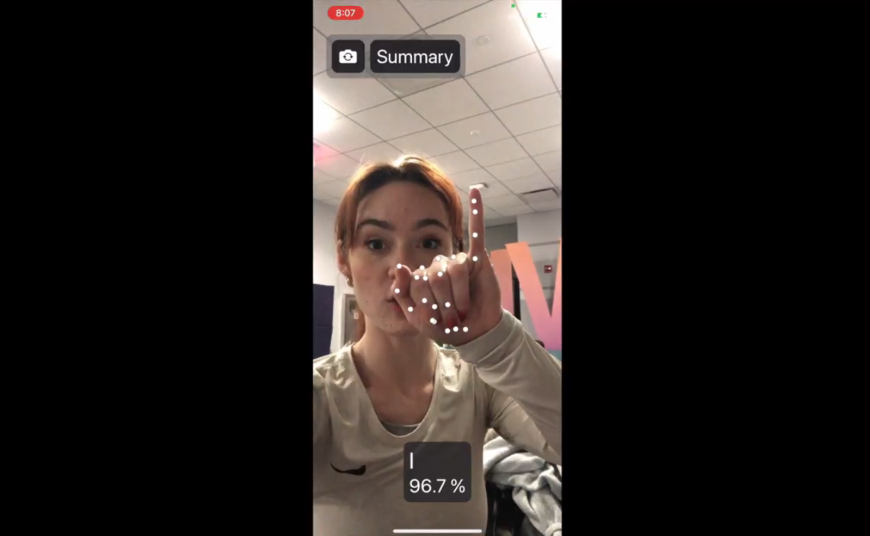

# ASL_Translate_Swift
A Sign Language translator app built in Swift

## Video Demo
Click to Play (opens new page)

For the link to the video demo of the application, click [here](https://drive.google.com/file/d/10kOkRgcT26_jOkyaPyjwuHE8A-DUPnL7/view).

### How to Use
v3 of this app is coming to TestFlight for beta testing and user training soon!

Keep your eye on this page as well as my [blog](https://igdaniel-1.github.io/pages/blog.html) for updates!

Here's how to test my app in the mean time...

# App Set-up
1. Download the code from this repositiory. 
2. Open the .xcodeproj file from this repo in XCode.
3. Open the project directory in the "Project Navigator" (the viewport for the files on the left side of the screen).
4. Underneath the section that says 'Project', find the section that says 'Targets' and select the Application 'Guess My Exercise'.
5. At the top navigation bar, select 'Signing and Capabilities' and look for the 'Team' dropdown menu.
6. Add your AppleID account as the Team. You may need to get a developer certificate. Check official Apple documentation for the latest way to obtain a developer certificate.

## Building the App and iPhone Deployment
1. Build the simulated version (a mock iPhone UI rendered on your desktop screen) by pressing the triangular play button in the top left corner of XCode. If errors persist, the iOS simulation version on your desktop may not be congruent with that of the iPhone you're testing.
2. To run the mobile application on an iPhone, connect your iPhone to the computer where you are running XCode.
3. At the top of the XCode IDE, find the name 'Guess My Exercise' and locate the '>' to its right. Click the listed device (i.e. My Mac... Any iOS Device) and change the target device to 'iPhone'.
4. Open your iPhone and allow the developer group to have access to your device. You may see an error 'Untrusted Developer'. If this occurs, navigate to your iPhone's Settings > General > VPN & Device Management. Then choose to trust the new 'Guess My Exercises' Application.

I recommend [this](https://buildfire.com/how-to-test-your-app-on-an-iphone-using-xcode/) mobile install and testing guide in case my instructions got you lost.

Good luck! I hope you like my app!